<strong>Lecturer in Chemistry · Researcher · Scientific Python Developer</strong>  
<em>Computational approaches to molecular discovery, analysis and reproducible research</em>

---

### 🔬 Research focus

**Chemoinformatics** · **QSAR and molecular machine learning** · **Structure-based drug discovery** · **Network pharmacology** · **Protein–ligand interactions** · **Reproducible scientific computing**

I work at the interface of chemistry, computation and drug discovery. My repositories bring together molecular modeling, scientific visualization, data workflows and software designed to make computational research more accessible and reproducible.

### 🚀 Featured scientific software

| Project | Focus |
|:---|:---|
| 🧬 **[PanDoc / PanDockLab](https://github.com/peterDataScientia/PanDoc)** | Molecular docking research software and workflows |
| 🔗 **[PanLigra](https://github.com/peterDataScientia/PanLigra)** | Protein–ligand interaction analysis and visual reporting |
| 🧪 **[RGroupStudio](https://github.com/peterDataScientia/RGroupStudio)** | R-group exploration and ligand design workflows |
| 📈 **[Figentra](https://github.com/peterDataScientia/figentra)** | Reproducible publication-quality scientific figure settings |
| 🧫 **[panChem](https://github.com/peterDataScientia/panChem)** | Chemistry-focused scientific tooling |
| 🎨 **[panVizPlus](https://github.com/peterDataScientia/panVizPlus)** | Scientific data visualization tools |

### 📚 Research projects and datasets

| Repository | Research area |
|:---|:---|
| [BD1-BD2](https://github.com/peterDataScientia/BD1-BD2) | BRD4 bromodomain datasets and modeling |
| [Network_Pharmacology](https://github.com/peterDataScientia/Network_Pharmacology) | Network pharmacology workflows |
| [BRD4-RVW](https://github.com/peterDataScientia/BRD4-RVW) | BRD4 literature synthesis |
| [JBU-HPU](https://github.com/peterDataScientia/JBU-HPU) | Comparative urease research |
| [PVC](https://github.com/peterDataScientia/PVC) | Perovskite solar-cell degradation modeling |
| [CardioDrugAI](https://github.com/peterDataScientia/CardioDrugAI) | Computational drug research |

### 🧰 Research toolkit

### 📊 GitHub activity

### 🐍 Contribution animation

<picture>
  <source media="(prefers-color-scheme: dark)" srcset="https://raw.githubusercontent.com/peterDataScientia/peterDataScientia/output/github-contribution-grid-snake-dark.svg" />
  
</picture>

The snake animation is generated by GitHub Actions after a successful workflow run.

---

<strong>From molecular questions to computational insight.</strong>

<a href="https://github.com/peterDataScientia?tab=repositories">Explore all repositories</a> · <a href="https://github.com/peterDataScientia/figentra">Scientific figure toolkit</a> · <a href="https://github.com/peterDataScientia/PanDoc">Docking software</a>

