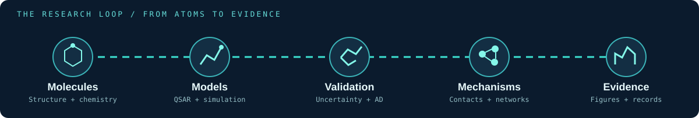
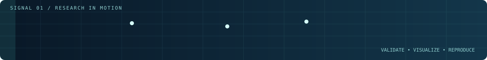

<!-- The laboratory, not a badge wall. -->

  
  
  
  

  

## 01 / THE SOFTWARE WORKBENCH

**Six tools. Six different research bottlenecks.** These are actual repositories—not generic placeholders.

<table>
<tr><td width="50%" valign="top">
  <h3>01 · <a href="https://github.com/peterDataScientia/PanDoc">PanDockLab</a></h3>
  
<strong>From receptor structure to defensible docking.</strong>

  
Guided receptor preparation, ligand chemistry review, crystallographic redocking, AutoDock Vina experiments and pose inspection.

  
<code>STRUCTURE</code> <code>PROTONATION</code> <code>REDOCKING</code> <code>VINA</code>

</td><td width="50%" valign="top">
  <h3>02 · <a href="https://github.com/peterDataScientia/PanLigra">PanLigra</a></h3>
  
<strong>Turn binding interactions into inspectable figures.</strong>

  
PLIP-based protein–ligand interaction analysis and publication-oriented SVG editing, keeping scientific measurements separate from visual annotations.

  
<code>PLIP</code> <code>CONTACTS</code> <code>SVG</code> <code>PROVENANCE</code>

</td></tr>
<tr><td valign="top">
  <h3>03 · <a href="https://github.com/peterDataScientia/RGroupStudio">RGroupStudio</a></h3>
  
<strong>Design chemical variation systematically.</strong>

  
Desktop R-group enumeration and molecular library design, with a Windows installer workflow.

  
<code>R-GROUPS</code> <code>ENUMERATION</code> <code>MOLECULAR LIBRARIES</code>

</td><td valign="top">
  <h3>04 · <a href="https://github.com/peterDataScientia/figentra">Figentra</a></h3>
  
<strong>Scientific figures, consistently refined.</strong>

  
A lightweight Matplotlib styling library for reproducible, publication-oriented graphics that changes presentation—not the underlying data.

  
<code>MATPLOTLIB</code> <code>REPRODUCIBLE STYLE</code> <code>PYPI</code>

</td></tr>
<tr><td valign="top">
  <h3>05 · <a href="https://github.com/peterDataScientia/panChem">panChem</a></h3>
  
<strong>Recover and review chemical structures from literature.</strong>

  
Research-PDF structure extraction with chemical review, SMILES QA and automated scientific processing.

  
<code>DECIMER</code> <code>SMILES</code> <code>CHEMICAL QA</code>

</td><td valign="top">
  <h3>06 · <a href="https://github.com/peterDataScientia/Network_Pharmacology">Network Pharmacology &amp; Toxicology Analyzer</a></h3>
  
<strong>From target lists to transparent network evidence.</strong>

  
STRING protein interaction networks, consensus-centrality hubs, functional enrichment and reproducible exports.

  
<code>STRING</code> <code>IGRAPH</code> <code>TOPOLOGY</code> <code>ENRICHMENT</code>

</td></tr>
</table>

## 02 / RESEARCH

<table>
<tr><th align="left">Research track</th><th align="left">Focus</th><th align="left">Repository</th></tr>
<tr><td>BRD4 bromodomains</td><td>Domain-aware BD1 / BD2 molecular data and modeling</td><td><a href="https://github.com/peterDataScientia/BD1-BD2">BD1-BD2</a></td></tr>
<tr><td>Network pharmacology</td><td>Target networks, hub interpretation and reproducible workflows</td><td><a href="https://github.com/peterDataScientia/Network_Pharmacology">Network_Pharmacology</a></td></tr>
<tr><td>Evidence synthesis</td><td>Computational BRD4 drug-repurposing literature</td><td><a href="https://github.com/peterDataScientia/BRD4-RVW">BRD4-RVW</a></td></tr>
<tr><td>Enzyme comparison</td><td>Jack-bean and <i>H. pylori</i> urease inhibitor evidence</td><td><a href="https://github.com/peterDataScientia/JBU-HPU">JBU-HPU</a></td></tr>
<tr><td>Materials informatics</td><td>Thermal degradation modeling in perovskite solar cells</td><td><a href="https://github.com/peterDataScientia/PVC">PVC</a></td></tr>
</table>

## 03 / THE MOVING LAB

  

**[Explore recent repository activity](https://github.com/peterDataScientia?tab=repositories)** · **[Browse open research tools](https://github.com/peterDataScientia?tab=repositories)**

---

  COMPUTATIONAL CHEMISTRY · MOLECULAR DISCOVERY · REPRODUCIBLE RESEARCH · BUILT IN TANZANIA
  
<strong>Explore the code. Inspect the assumptions. Reproduce the science.</strong>

  <a href="https://github.com/peterDataScientia?tab=repositories">FULL REPOSITORY INDEX</a> ·
  <a href="https://github.com/peterDataScientia/PanLigra">INTERACTION VISUALIZATION</a> ·
  <a href="https://github.com/peterDataScientia/figentra">FIGURE TOOLKIT</a>

